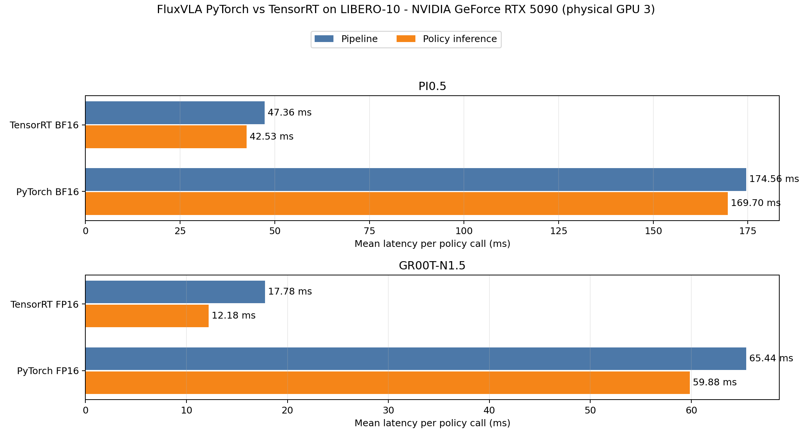

# TensorRT Deployment

TensorRT inference for FluxVLA PI0.5 and GR00T-N1.5:

```text
checkpoint -> ONNX partitions -> TensorRT plans -> FluxVLA evaluation
```

- PI0.5: Vision, Prefix, and Denoise plans.
- GR00T-N1.5: ViT, LLM, backbone processor, state encoder, action encoder,
  DiT, and action decoder plans.
- The TensorRT acceleration path does not invoke FluxVLA's Triton kernels or
  enable CUDA Graph.
- The original eager PyTorch path remains selectable.

The GR00T partition boundaries and benchmark style follow the
[Isaac-GR00T N1.5 deployment design](https://github.com/NVIDIA/Isaac-GR00T/blob/n1.5-release/deployment_scripts/README.md).
This is FluxVLA's static deployment implementation, not NVIDIA's Thor FP8/FP4
engine.
Run every command below from the FluxVLA source root.

## 1. Environment

Install FluxVLA first, then the optional deployment packages:

```bash
python -m pip install -r requirements-tensorrt.txt
python -c "import onnx, tensorrt; print(onnx.__version__, tensorrt.__version__)"
```

The reusable runtime under `fluxvla/deployment/tensorrt` is included in the
FluxVLA package. The CLI scripts, configs, and this guide are source-tree
tools, so export, build, smoke, parity, and benchmark commands require a
FluxVLA source checkout.

The pip requirements do not install `trtexec`. Install the matching full
TensorRT SDK separately. The Python bindings and `trtexec` must have the same
`major.minor.patch` version.

```bash
trtexec --version
# If it is not in PATH:
export TRTEXEC=/absolute/path/to/trtexec
```

For an SDK `trtexec` used with pip-installed TensorRT libraries, expose the
matching shared libraries before build or benchmark commands:

```bash
TRT_LIB_DIR=$(python -c \
  'import pathlib, tensorrt_libs; print(pathlib.Path(tensorrt_libs.__file__).resolve().parent)')
export LD_LIBRARY_PATH="${TRT_LIB_DIR}${LD_LIBRARY_PATH:+:${LD_LIBRARY_PATH}}"
```

### Supported profiles

| Model      | Floating-point profile                                         | Static profile                                                                    |
| ---------- | -------------------------------------------------------------- | --------------------------------------------------------------------------------- |
| PI0.5      | BF16 main neural compute; FP32 flow state and returned actions | Batch 1, two 224x224 views, 180 language tokens, horizon 10, 10 Euler steps       |
| GR00T-N1.5 | FP16 main neural compute; FP32 returned actions                | Batch 1, two 224x224 views, sequence length 600, horizon 10, four denoising steps |

The reference installation is Linux x86_64, CUDA 12, and TensorRT 11.1. The
RTX 5090 has passed the full benchmark in Section 6, and the RTX 3090 has
passed real-plan smoke and numerical-parity checks. Other RTX, A-series, and
H-series GPUs require rebuilding and revalidation. The current pip
requirements do not support aarch64 Jetson Orin or Thor; those platforms need
their platform TensorRT/JetPack stack and have not been validated here.

TensorRT plans are not treated as portable. Rebuild them after changing the
GPU architecture or TensorRT version. Supporting a different camera count,
batch, sequence length, action shape, or solver schedule requires changing the
contract, exporting ONNX again, rebuilding plans, and repeating validation.
The examples below select physical GPU3 for the documented experiment. Replace
`3` on another host; after masking, the process sees that card as logical
`cuda:0`.

Both v1 profiles require exactly two present, valid camera views. The documented
LIBERO transform always emits `img_masks=[[True, True]]`; image validity is
baked into the exported graphs rather than exposed as a TensorRT binding.
Missing or variably valid views are unsupported. PI0.5 itself does not condition
actions on robot-state values (`state_proj` is disabled); its `states` argument
is retained for FluxVLA API, batch, dtype, and device compatibility.

## 2. Export ONNX

```bash
# PI0.5
CUDA_DEVICE_ORDER=PCI_BUS_ID CUDA_VISIBLE_DEVICES=3 \
  python -m deployment_scripts.tensorrt.export_onnx pi05 \
  --config configs/pi05/pi05_paligemma_libero_10_full_finetune.py \
  --checkpoint checkpoints/pi05_paligemma_libero_10_full_finetune_bs64/checkpoints/step-038064-epoch-24-loss=0.0170.safetensors

# GR00T-N1.5
CUDA_DEVICE_ORDER=PCI_BUS_ID CUDA_VISIBLE_DEVICES=3 \
  python -m deployment_scripts.tensorrt.export_onnx groot-n15 \
  --config configs/gr00t/gr00t_eagle_3b_libero_10_full_finetune.py \
  --checkpoint checkpoints/gr00t_eagle_3b_libero_10_full_finetune_bs64/checkpoints/step-028548-epoch-18-loss=0.0546.safetensors \
  --sequence-length 600
```

The default outputs are `deployment_artifacts/onnx/pi05` and
`deployment_artifacts/onnx/groot_n15`. Each complete export is published as a
directory and contains `export_manifest.json`, graph hashes, static shapes,
and checkpoint identity.

## 3. Build Plans

```bash
CUDA_DEVICE_ORDER=PCI_BUS_ID CUDA_VISIBLE_DEVICES=3 \
  bash deployment_scripts/tensorrt/build_engine.sh \
  pi05 deployment_artifacts/onnx/pi05 deployment_artifacts/engines/pi05

CUDA_DEVICE_ORDER=PCI_BUS_ID CUDA_VISIBLE_DEVICES=3 \
  bash deployment_scripts/tensorrt/build_engine.sh \
  groot-n15 deployment_artifacts/onnx/groot_n15 \
  deployment_artifacts/engines/groot_n15
```

The build writes verbose TensorRT logs, a timing cache, plan hashes, and
`engine_manifest.json`. Runtime loading fails if the plan bundle, checkpoint,
TensorRT version, or static contract does not match.
Use the physical target GPU when building; the commands above select GPU3 for
the formal experiment in this document.

## 4. Validate

Run one real-plan inference for each model:

```bash
CUDA_DEVICE_ORDER=PCI_BUS_ID CUDA_VISIBLE_DEVICES=3 \
  python -m deployment_scripts.tensorrt.smoke_test pi05 \
  --engine-dir deployment_artifacts/engines/pi05 \
  --checkpoint checkpoints/pi05_paligemma_libero_10_full_finetune_bs64/checkpoints/step-038064-epoch-24-loss=0.0170.safetensors

CUDA_DEVICE_ORDER=PCI_BUS_ID CUDA_VISIBLE_DEVICES=3 \
  python -m deployment_scripts.tensorrt.smoke_test groot-n15 \
  --engine-dir deployment_artifacts/engines/groot_n15 \
  --checkpoint checkpoints/gr00t_eagle_3b_libero_10_full_finetune_bs64/checkpoints/step-028548-epoch-18-loss=0.0546.safetensors
```

Compare native PyTorch, the ONNX export wrapper, and TensorRT with identical
synthetic inputs and explicit noise:

```bash
CUDA_DEVICE_ORDER=PCI_BUS_ID CUDA_VISIBLE_DEVICES=3 \
  python -m deployment_scripts.tensorrt.parity_check pi05 \
  --engine-dir deployment_artifacts/engines/pi05 \
  --checkpoint checkpoints/pi05_paligemma_libero_10_full_finetune_bs64/checkpoints/step-038064-epoch-24-loss=0.0170.safetensors

CUDA_DEVICE_ORDER=PCI_BUS_ID CUDA_VISIBLE_DEVICES=3 \
  python -m deployment_scripts.tensorrt.parity_check groot-n15 \
  --engine-dir deployment_artifacts/engines/groot_n15 \
  --checkpoint checkpoints/gr00t_eagle_3b_libero_10_full_finetune_bs64/checkpoints/step-028548-epoch-18-loss=0.0546.safetensors
```

## 5. LIBERO-10 Benchmark

The formal protocol uses one GPU, all 10 LIBERO-10 tasks, 50 trials per task,
five model-only warm-up calls, no rollout videos, and a deterministic changing
noise seed (`7 + episode-local model-call index`). Simulator stepping is not
part of the latency metric.

| Run                      | Config                                                   | Comparison role                      |
| ------------------------ | -------------------------------------------------------- | ------------------------------------ |
| PI0.5 PyTorch BF16       | `configs/pi05/pi05_paligemma_libero_10_pytorch.py`       | PI0.5 speed and quality baseline     |
| PI0.5 TensorRT BF16      | `configs/pi05/pi05_paligemma_libero_10_tensorrt.py`      | PI0.5 TensorRT                       |
| GR00T-N1.5 PyTorch BF16  | `configs/gr00t/gr00t_eagle_3b_libero_10_pytorch.py`      | Original-precision quality reference |
| GR00T-N1.5 PyTorch FP16  | `configs/gr00t/gr00t_eagle_3b_libero_10_pytorch_fp16.py` | Fair GR00T speed denominator         |
| GR00T-N1.5 TensorRT FP16 | `configs/gr00t/gr00t_eagle_3b_libero_10_tensorrt.py`     | GR00T TensorRT                       |

The supplied runner executes all five rows with paired initial states, a
deterministic per-episode seed schedule, checkpoint path, and solver settings,
keeps their raw artifacts in separate directories, and invokes the strict
summarizer only after every run completes:

```bash
bash deployment_scripts/tensorrt/run_libero_benchmark.sh \
  3 benchmark_results/pi05_gr00t_tensorrt_gpu3
```

The first argument is the physical GPU index and the second must be a new or
empty output directory. The script rejects nonempty output directories to
prevent stale artifacts from being mixed into a new run. It records
`CUDA_VISIBLE_DEVICES`, `nvidia-smi`, the Git
state, Python packages, all console logs, and the resolved directory of every
run. Set `PI05_CHECKPOINT` or `GROOT_CHECKPOINT` only when the checkpoints are
stored outside the documented default paths.

Every run writes `time_profile/inference_calls.csv`. Its principal fields are:

- `inference_ms`: synchronized complete `predict_action` wall time, including
  TensorRT execution and the surrounding PyTorch orchestration.
- `pipeline_total_ms`: preprocessing + inference + output transfer + action
  denormalization.
- module fields: CUDA-event attribution for PI0.5 V/P/D or GR00T backbone and
  action-head partitions.
- `initial_state_sha256` and `inference_seed`: pairing evidence.

Both compared paths enable the same stage schema and expected call counts;
`inference_ms` includes their CUDA-event profiling overhead. The paths may
produce different trajectories after their actions diverge, so the report also
retains measured call counts and success rates. The official plan-only numbers
below are measured separately by `trtexec` without these events.

"TensorRT-backed" means that every exported neural partition is executed by a
TensorRT plan with no PyTorch neural fallback. Tensor assembly, random-number
generation, and other lightweight orchestration remain in PyTorch. PI0.5 folds
each Euler update into its denoise plan; GR00T performs its Euler update in the
PyTorch orchestration between DiT calls.

The GR00T speedup is calculated from PyTorch FP16 versus TensorRT FP16. PyTorch
BF16 is kept as a separate quality reference; comparing BF16 directly with
FP16 would mix backend and precision effects.

### Official plan benchmark

Use `trtexec` with synthetic inputs to measure each serialized plan without
H2D/D2H or CUDA Graph:

```bash
CUDA_DEVICE_ORDER=PCI_BUS_ID CUDA_VISIBLE_DEVICES=3 \
  bash deployment_scripts/tensorrt/benchmark_engines.sh \
  pi05 deployment_artifacts/engines/pi05 benchmark_results/trtexec/pi05

CUDA_DEVICE_ORDER=PCI_BUS_ID CUDA_VISIBLE_DEVICES=3 \
  bash deployment_scripts/tensorrt/benchmark_engines.sh \
  groot-n15 deployment_artifacts/engines/groot_n15 \
  benchmark_results/trtexec/groot_n15
```

These standalone plan measurements exclude inter-plan PyTorch orchestration,
tensor assembly, casts, random-number generation, and data transfers. The
PI0.5 denoise plan includes one Euler update; GR00T's Euler update remains
outside its plans. These numbers are not complete VLA or rollout latency.

## 6. Performance

### 6.1 Environment and protocol

The corrected formal run completed on 2026-08-06 with the protocol in Section
5\. The model and evaluation processes used a clean checkout at commit
`ae27b27efd5059d96bb1e0c7ba1e803ee4872d3a`; the exact stricter postprocessor
source and its patch are archived with the results. Postprocessing did not
change model execution.

| Item             | Value                                                         |
| ---------------- | ------------------------------------------------------------- |
| Physical device  | GPU3, NVIDIA GeForce RTX 5090 (Blackwell)                     |
| GPU UUID         | `GPU-8b6c9890-590e-76ab-e57f-6866ab476940`                    |
| Driver / CUDA    | 580.126.09 / 13.0 reported by `nvidia-smi`                    |
| Python / PyTorch | Python 3.10 / PyTorch 2.8.0+cu128                             |
| ONNX / TensorRT  | ONNX 1.18.0 / TensorRT Python and `trtexec` 10.13.0.35        |
| Trial protocol   | 10 tasks x 50 trials, batch 1, 5 warm-up calls, single GPU    |
| Seed protocol    | Initial-state pairing and per-episode inference seeds `7 + i` |

The reference dependency file currently pins TensorRT 11.1, while this server
run used its installed TensorRT 10.13 stack. Python runtime, `trtexec`, build,
and evaluation all used the same 10.13 version. Both plan bundles were built
and benchmarked on the RTX 5090 above; the build logs record its name and UUID.

| Model      | Checkpoint SHA256                                                  | Engine-manifest SHA256                                             |
| ---------- | ------------------------------------------------------------------ | ------------------------------------------------------------------ |
| PI0.5      | `4a79542cbb79b75deea3804d91f87f9c2180ff704f0cd1988469ee72655fbe15` | `acd3b876881fe73f0b077bf06d208936cd50d29362e184498c79e13380ef0d0d` |
| GR00T-N1.5 | `f2485a81646356973d21f9c08075fbe3ba567f283ab16e31793fd682fdbb27c5` | `6853bdfd786c065e583e886cd9adf1bbcda37c948b5efec87772860b7e279394` |

### 6.2 End-to-end policy results

Latency is the pooled mean +/- population standard deviation across measured
policy calls, not variation across independent benchmark runs. A call returns
one horizon-10 action chunk. Different rollout outcomes produce different call
counts, so calls and success rates are reported alongside latency. Simulator
stepping is excluded.

| Model      | Backend / role                 | Trials | Successes | Success rate |  Calls | Policy inference (ms) | Speedup |   Pipeline (ms) | Speedup |
| ---------- | ------------------------------ | -----: | --------: | -----------: | -----: | --------------------: | ------: | --------------: | ------: |
| PI0.5      | PyTorch BF16 baseline          |    500 |       484 |        96.8% | 13,151 |       169.70 +/- 0.87 |   1.00x | 174.56 +/- 0.95 |   1.00x |
| PI0.5      | TensorRT BF16                  |    500 |       482 |        96.4% | 13,104 |        42.53 +/- 0.07 |   3.99x |  47.36 +/- 0.20 |   3.69x |
| GR00T-N1.5 | PyTorch BF16 quality reference |    500 |       454 |        90.8% | 13,692 |        59.67 +/- 0.63 |       - |  65.25 +/- 0.75 |       - |
| GR00T-N1.5 | PyTorch FP16 speed baseline    |    500 |       449 |        89.8% | 13,775 |        59.88 +/- 0.63 |   1.00x |  65.44 +/- 0.76 |   1.00x |
| GR00T-N1.5 | TensorRT FP16                  |    500 |       441 |        88.2% | 13,944 |        12.18 +/- 0.08 |   4.92x |  17.78 +/- 0.24 |   3.68x |

PI0.5 TensorRT changed observed success by -0.4 percentage points relative to
its BF16 baseline. GR00T TensorRT changed observed success by -1.6 points
relative to the fair FP16 baseline; most of the difference occurred on task 8.
These are single-seed 50-trial observations, not a statistical equivalence
claim.



### 6.3 Per-task success

|  ID | LIBERO-10 task (short name)            | PI PyTorch | PI TensorRT | GR BF16 | GR FP16 | GR TensorRT |
| --: | -------------------------------------- | ---------: | ----------: | ------: | ------: | ----------: |
|   0 | Alphabet soup + tomato sauce to basket |      47/50 |       47/50 |   49/50 |   45/50 |       47/50 |
|   1 | Cream cheese + butter to basket        |      50/50 |       50/50 |   50/50 |   49/50 |       49/50 |
|   2 | Turn on stove + place moka pot         |      50/50 |       49/50 |   48/50 |   47/50 |       49/50 |
|   3 | Black bowl to bottom drawer + close    |      49/50 |       50/50 |   50/50 |   48/50 |       49/50 |
|   4 | Two mugs to left/right plates          |      48/50 |       50/50 |   47/50 |   46/50 |       46/50 |
|   5 | Book to back compartment of caddy      |      50/50 |       50/50 |   48/50 |   50/50 |       49/50 |
|   6 | Mug to plate + pudding to its right    |      47/50 |       46/50 |   40/50 |   40/50 |       37/50 |
|   7 | Alphabet soup + cream cheese to basket |      49/50 |       48/50 |   49/50 |   49/50 |       50/50 |
|   8 | Both moka pots to stove                |      46/50 |       46/50 |   29/50 |   31/50 |       18/50 |
|   9 | Mug to microwave + close               |      48/50 |       46/50 |   44/50 |   44/50 |       47/50 |

### 6.4 Module attribution

Each number below is an aggregate per policy call. PI0.5 `denoise_step` is a
nested diagnostic inside `denoise`, so those rows must not be added. The
TensorRT denoise plan includes its Euler update.

| PI0.5 module | Calls | PyTorch BF16 (ms) | TensorRT BF16 (ms) | Speedup |
| ------------ | ----: | ----------------: | -----------------: | ------: |
| Vision       |     1 |  16.801 +/- 0.200 |    4.368 +/- 0.033 |   3.85x |
| Prefix       |     1 |  24.126 +/- 0.074 |   15.042 +/- 0.011 |   1.60x |
| Denoise      |     1 | 128.489 +/- 0.708 |   22.859 +/- 0.013 |   5.62x |
| Denoise step |    10 | 127.490 +/- 0.698 |   22.852 +/- 0.013 |   5.58x |

For GR00T, `vit` and `llm` are nested inside `backbone_total`;
`action_encoder`, `dit`, and `action_decoder` are nested inside
`action_expert`. Top-level and nested rows likewise must not be added.

| GR00T-N1.5 module  | Calls | PyTorch FP16 (ms) | TensorRT FP16 (ms) | Speedup |
| ------------------ | ----: | ----------------: | -----------------: | ------: |
| Backbone total     |     1 |  27.242 +/- 0.398 |    5.638 +/- 0.059 |   4.83x |
| ViT                |     1 |  11.244 +/- 0.214 |    2.439 +/- 0.035 |   4.61x |
| LLM                |     1 |  15.641 +/- 0.200 |    3.042 +/- 0.021 |   5.14x |
| Backbone processor |     1 |   1.690 +/- 0.005 |    0.897 +/- 0.001 |   1.88x |
| State encoder      |     1 |   0.048 +/- 0.001 |    0.016 +/- 0.001 |   3.00x |
| Action expert      |     1 |  30.748 +/- 0.270 |    5.460 +/- 0.008 |   5.63x |
| Action encoder     |     4 |   1.284 +/- 0.027 |    0.144 +/- 0.003 |   8.92x |
| DiT                |     4 |  28.123 +/- 0.253 |    5.198 +/- 0.007 |   5.41x |
| Action decoder     |     4 |   0.722 +/- 0.018 |    0.058 +/- 0.003 |  12.53x |

### 6.5 Official `trtexec` plan benchmark

These are GPU-compute measurements for one invocation of each serialized plan
with synthetic inputs, no data transfers, and no CUDA Graph. `Calls/policy`
shows how often the runtime invokes that plan for one policy call.

| Model | Plan               | Calls/policy | Mean (ms) | Median (ms) | P95 (ms) | Throughput (qps) |
| ----- | ------------------ | -----------: | --------: | ----------: | -------: | ---------------: |
| PI0.5 | Vision             |            1 |     4.241 |       4.242 |    4.250 |          235.696 |
| PI0.5 | Prefix             |            1 |    15.942 |      15.940 |   15.987 |           62.722 |
| PI0.5 | Denoise            |           10 |     2.212 |       2.211 |    2.217 |          451.952 |
| GR00T | ViT                |            1 |     2.399 |       2.399 |    2.407 |          416.599 |
| GR00T | LLM                |            1 |     3.224 |       3.224 |    3.230 |          310.095 |
| GR00T | Backbone processor |            1 |     1.001 |       1.001 |    1.004 |          998.581 |
| GR00T | State encoder      |            1 |     0.014 |       0.014 |    0.015 |       64,636.300 |
| GR00T | Action encoder     |            4 |     0.030 |       0.030 |    0.030 |       32,510.700 |
| GR00T | DiT                |            4 |     1.294 |       1.294 |    1.299 |          771.937 |
| GR00T | Action decoder     |            4 |     0.015 |       0.015 |    0.017 |       62,241.500 |

Applying the documented invocation counts gives 42.30 ms for the three PI0.5
plans and 11.99 ms for the seven GR00T plans. The difference from policy
inference includes inter-plan orchestration, retained lightweight PyTorch
operations, RNG, and profiling overhead.

### 6.6 Numerical validation

Both real-plan smoke tests returned finite FP32 output: PI0.5 `[1, 10, 32]`
and GR00T `[1, 10, 7]`. Parity used identical synthetic inputs and explicit
noise.

| Model | Comparison          |  Max abs |     RMSE |    Cosine | Result |
| ----- | ------------------- | -------: | -------: | --------: | ------ |
| PI0.5 | PyTorch vs wrapper  | 0.014923 | 0.003073 | 0.9999848 | pass   |
| PI0.5 | Wrapper vs TensorRT | 0.028320 | 0.004795 | 0.9999679 | pass   |
| PI0.5 | PyTorch vs TensorRT | 0.041077 | 0.006207 | 0.9999494 | pass   |
| GR00T | PyTorch vs wrapper  | 0.005490 | 0.001024 | 0.9999998 | pass   |
| GR00T | Wrapper vs TensorRT | 0.048828 | 0.009200 | 0.9999833 | pass   |
| GR00T | PyTorch vs TensorRT | 0.054318 | 0.009822 | 0.9999809 | pass   |

PI0.5 thresholds were max-abs \<= 0.05, RMSE \<= 0.01, and cosine >= 0.999.
GR00T thresholds were max-abs \<= 0.08, RMSE \<= 0.015, and cosine >= 0.999.

### 6.7 Artifacts

The local result root is
`benchmark_results/pi05_gr00t_trt_gpu3_corrected_20260805_235000` and contains:

- `summary_verified/benchmark_summary.csv`: five-run headline metrics;
- `summary_verified/module_summary.csv`: module attribution;
- `summary_verified/task_summary.csv`: all 5-config x 10-task success rows;
- `summary_verified/benchmark_data.json`: validated calls, states, seeds, and
  outcomes;
- the five run directories: raw `inference_calls.csv`, summaries, environment,
  and console logs;
- `trtexec/`: official times, profiles, and logs for all ten plans;
- `preparation/`: export, build, smoke, parity, and GPU-identified build logs;
- `environment/`: commit, clean status, package list, GPU identity, manifests,
  engine hashes, and exact postprocessor source.

The downloaded raw-result archive is
`benchmark_results/pi05_gr00t_trt_gpu3_corrected_20260805_235000.tar.gz`, with
SHA256 `2a63f7e69965986d016446d0be122d957cbc9c94587bf7d43eaa04ed4257ea4b`.
